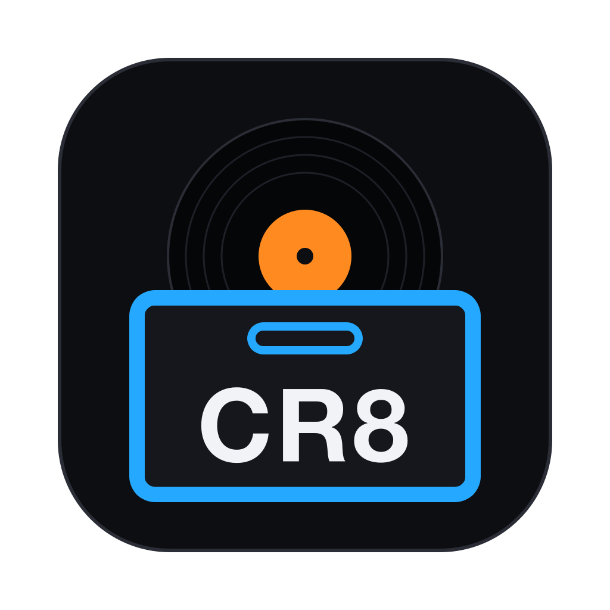

<h1>&nbsp;CR8TXXX</h1>

*A library and crate management tool for MIXXX DJ Software, Mac Installer*

A Mac app for managing a [Mixxx](https://mixxx.org) DJ library from outside Mixxx: build and
edit **crates** by drag and drop, tidy the library, and **find damaged music files** before
they break in the middle of a set.

CR8TXXX works directly on the library database Mixxx keeps (`mixxxdb.sqlite`), so crates and
changes made here show up in Mixxx the next time it opens.

## Features

**Crates**
- Create, rename, delete, lock and hide crates, and set Auto DJ sources
- Drag tracks from the library onto a crate, or into the crate's track list
- Import an M3U playlist as a crate, and export a crate as M3U

**Library**
- One window: the library on the left, your crates at top right, the selected crate's
  tracks below. Sort, search, and pick and arrange columns.
- Drag music files or folders in from Finder to add them, optionally straight into a crate
- **Find New Songs**: looks through Mixxx's music folders for songs not in the library yet
  and adds them with their tags. Mixxx analyzes BPM, key and beat grid itself.
- Edit track details (one or many at once), hide and unhide, purge
- **Relocate** missing files by pointing at, or dropping, the folder they moved to

**Damaged file scan**
- One button checks every file:
  - MP3s frame by frame for repeated blocks of audio and breaks
  - other formats by decoding them with ffmpeg
- Damaged tracks are marked **red** everywhere, and Mixxx's Comment gets
  `DAMAGED DO NOT USE - DELETE AND REPLACE THIS SONG`. Suspect files are marked amber.
- **Verified Undamaged by Listening** (right-click) clears a mark you've checked by ear.
  The mark survives rescans and goes away if the file is replaced.
- Later scans only read new or changed files. Results can go into a "Damaged Files" crate
  or a CSV.

**Safe with Mixxx**
- Changes are only made while Mixxx is closed. A banner says so while it's open, and the
  damage notes wait until it quits.
- Before the first change of each session, CR8TXXX saves a backup copy of the library
  (File › Show Backups in Finder).
- Unknown database versions open read-only. Music files are never moved or deleted.

The look follows a dark DJ-software palette, with a text size setting (⌘+ / ⌘−) for large
and 4K displays.

## Requirements

- A Mac with Apple silicon (M1 or later), macOS 13 or later
- Mixxx 2.4, 2.5 or 2.6 (library database schema 33–44; tested with 2.5.6 and 2.6.0),
  opened at least once with your music folder added (Mixxx › Preferences › Library)

## Install

1. Download `CR8TXXX-<version>.dmg` from [Releases](../../releases), open it, and drag
   **CR8TXXX** into **Applications**.
2. Open CR8TXXX. The **Set Up CR8TXXX** window checks what the Mac needs and asks before
   changing anything:
   - **Full Disk Access.** Mixxx keeps its library in a folder macOS protects. Setup opens
     System Settings › Privacy & Security › Full Disk Access: turn on CR8TXXX, then quit
     and reopen it.
   - **ffmpeg** (for checking files other than MP3). If it isn't on the Mac, **Download &
     Install** puts it in CR8TXXX's own folder. No password is needed, and it's about 80 MB,
     downloaded once. Without it, the scan still checks MP3s. An ffmpeg you already have
     (`brew install ffmpeg`) is used as is.

   Setup can be reopened from Help › Set Up CR8TXXX….

If macOS says it can't check CR8TXXX for malicious software (a build that isn't notarized),
go to System Settings › Privacy & Security and click **Open Anyway**. You only need to do
this once.

## Build from source

You need [uv](https://docs.astral.sh/uv/) and Python 3.12. To check formats other than MP3
when running from source, you also need ffmpeg (`brew install ffmpeg`).

```sh
make run        # run from source
make test       # the tests (offscreen; no Mixxx or library of yours is touched)
make lint
make dist       # CR8TXXX.app and the DMG, signed with your Developer ID if you have one
make notarize   # send the DMG to Apple's notary service and staple the ticket
make ffmpeg     # optional: build an audio-only LGPL ffmpeg to bundle inside the app
```

Builds go to `~/Library/Caches/CR8TXXX-build` (`dist/` links there). The `.venv` is a link to
`.venv.nosync`, so iCloud Drive leaves it alone if the project sits in Documents.

| Folder | What's in it |
|---|---|
| `src/cr8txxx/db/` | the Mixxx database: opening it safely, tracks and crates |
| `src/cr8txxx/scan/` | the damaged-file checker, its results file, and ffmpeg |
| `src/cr8txxx/ui/` | the window, panes, dialogs, theme and icons |
| `packaging/` | the PyInstaller recipe, signing, the DMG, the icon and the ffmpeg build |
| `tests/` | pytest: a stand-in Mixxx database, real damaged MP3s, and the window offscreen |

CR8TXXX's own data lives in `~/Library/Application Support/CR8TXXX`: backups, scan results,
verified marks and ffmpeg. Delete that folder, and the app, to remove CR8TXXX completely.

## Licence

CR8TXXX is free software under the **GNU General Public License v3.0 or later**: see
[LICENSE](LICENSE). It is built with Qt and PySide6 (LGPL-3.0), Python (PSF) and tinytag
(MIT). Their notices are in [THIRD_PARTY_NOTICES.md](THIRD_PARTY_NOTICES.md) and
[licenses/](licenses/), and inside the app under Help › About CR8TXXX.

The music-file checker comes from FMM, by the same author.

CR8TXXX isn't part of, or endorsed by, the Mixxx project. Mixxx is a trademark of its
respective owners. Keep backups of your library: CR8TXXX makes one before changing it, but
use it at your own risk (see the warranty disclaimer in the licence).
